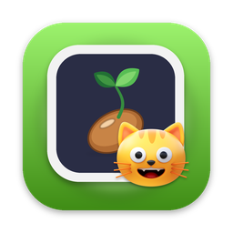
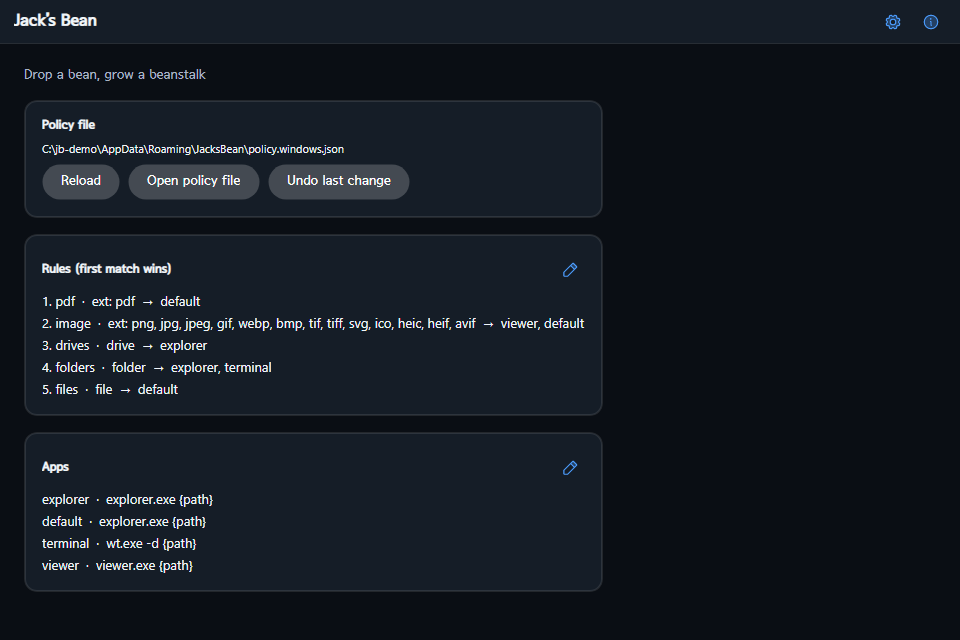
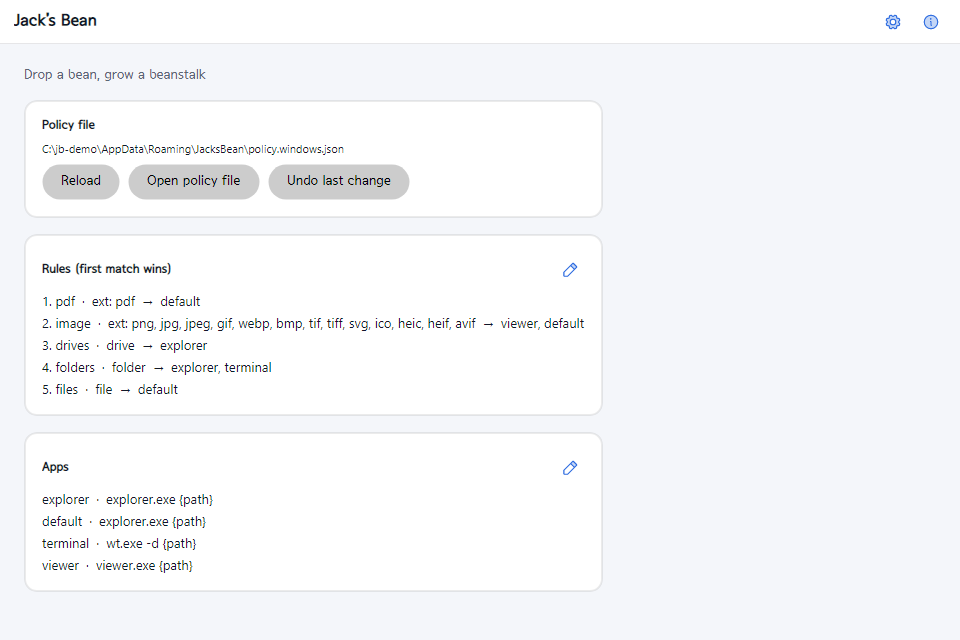
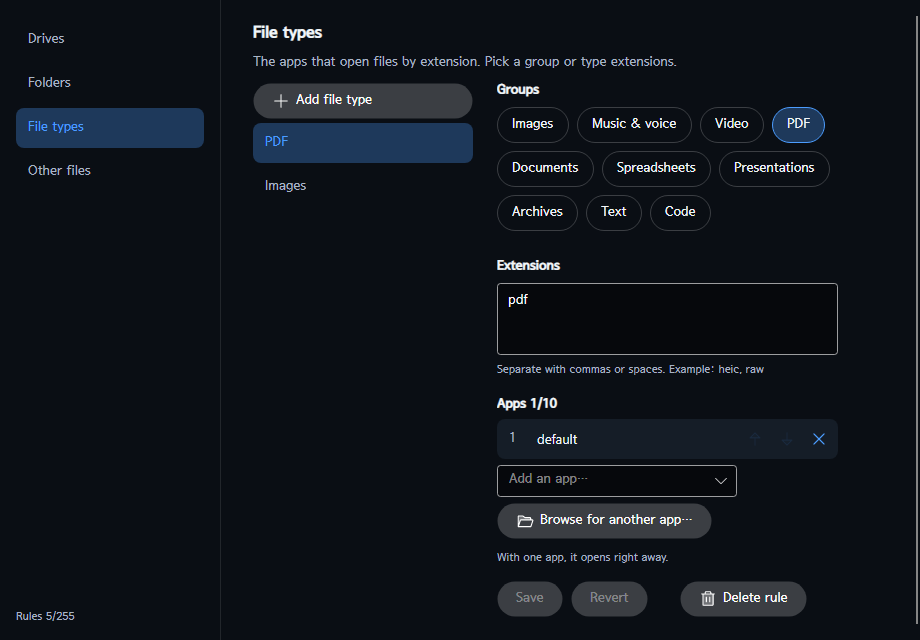

<div align="center">



# Jack’s Bean

**콩 하나를 떨어뜨리면 알맞은 앱으로 자랍니다** — 작은 독에 파일·폴더·드라이브를 끌어다 놓으면 *내가 정한 규칙*에 따라 알맞은 앱으로 열어 주는, Windows·macOS·Linux용 무료 오픈소스 **드래그 앤 드롭 런처**입니다.

[](https://github.com/jejezz/jacksbean-avalonia/releases/latest)
[](https://github.com/jejezz/jacksbean-avalonia/releases)
[](#설치)
[](https://learn.microsoft.com/dotnet/core/deploying/native-aot/)
[](LICENSE)

[English](README.md) · 한국어

</div>

## 스크린샷

| 홈 — 다크 | 홈 — 라이트 |
| :---: | :---: |
|  |  |



*(스크린샷은 영어 화면입니다. 설정에서 한국어로 바꿀 수 있습니다.)*

## 기능

- **읽을 수 있는 규칙** — 대상은 네 가지: **드라이브**, **폴더**, **파일 형식**(확장자), **그 밖의 파일**. 대상마다 앱을 **10개**까지 연결합니다. 앱이 하나면 바로 열고, 둘 이상이면 *그 앱들만* 보여 주며 고르게 합니다(폴더를 놓았는데 PDF 앱이 뜨는 일이 없습니다).
- **JSON 없이 편집** — 확장자 묶음(이미지·음악·음성·영상·PDF·문서·스프레드시트·프레젠테이션·압축·텍스트·코드), 최대 **255개 규칙**, 겹침 검사, 연결한 앱의 순서 바꾸기, 한 단계 **실행 취소**. *다른 앱 찾아보기…* 로 어떤 프로그램이든 고를 수 있습니다.
- **“항상 이렇게 열기”** — 앱 고르기에서 체크하면 규칙이 알아서 저장됩니다.
- **내장 이미지 뷰어** — 별도 창으로, 파일 하나에 창 하나씩 엽니다.
- **GitHub로 여러 PC 동기화** — 브라우저로 로그인(OAuth 장치 흐름)하고, 비공개 저장소를 고르거나 만든 뒤 *지금 동기화*를 누릅니다. 규칙과 앱은 **항목 단위**로 합쳐집니다(더 최근에 고친 쪽이 이기고, 지운 것은 따라 지워집니다). git이 필요 없고, 토큰은 OS 보안 저장소(자격 증명 관리자·키체인·libsecret)에만 보관됩니다.
- **방해하지 않는 독** — 화면 가장자리에 있고, 놓은 자리를 기억하며, 위로 끌어오면 테두리가 켜집니다. 트레이 아이콘, **전역 단축키**(Ctrl+Alt+J, Windows), **로그인할 때 자동 시작**은 설정에서 켭니다.
- **보기 좋게** — 라이트/다크, 고대비를 포함한 색 구성 6가지, 글자 크기 80~160%, 한국어/영어, 서울남산체 번들(파일 이름은 시스템 글꼴 선택 가능).
- **작고 빠르게** — **NativeAOT** 실행 파일 하나, .NET 런타임을 따로 설치하지 않습니다.

## 설치

[최신 릴리스](https://github.com/jejezz/jacksbean-avalonia/releases/latest)에서 OS에 맞는 파일을 받으세요(`<version>`은 릴리스 번호입니다):

| OS | 파일 | 참고 |
|---|---|---|
| Windows 10/11 (x64) | `JacksBean-<version>-windows-x64-setup.exe` 또는 `…-windows-x64.zip` | 아직 코드 서명이 없어서 SmartScreen이 “Windows의 PC 보호” 창을 띄웁니다. **추가 정보 → 실행**을 누르세요. |
| macOS (Apple Silicon, 11.0 이상) | `JacksBean-<version>-macos-arm64.dmg` | 아직 공증 전이라 **우클릭 → 열기**로 한 번 여시거나 `xattr -dr com.apple.quarantine "/Applications/Jack’s Bean.app"` 을 실행하세요. |
| Linux (x64) | `JacksBean-<version>-linux-x64.tar.gz` | 압축을 풀고 `./install.sh`를 실행하세요(`--remove`로 제거). X11/XWayland에서 실행되고, 트레이 아이콘은 StatusNotifier를 지원하는 데스크톱에서 보이며 전역 단축키는 없습니다. |

받은 파일은 `SHA256SUMS.txt`로 확인합니다: `shasum -a 256 -c SHA256SUMS.txt --ignore-missing`.

**처음 실행하기**: 독(화면 가장자리의 작은 원)에 무언가를 끌어다 놓아 보세요. 독을 더블클릭하거나 트레이 아이콘으로 홈 창을 열면 규칙과 앱을 편집할 수 있습니다. 정책은 사용자 데이터 폴더 `JacksBean`의 일반 JSON 파일(`policy.<os>.json`)입니다.

## 동작 방식

독은 항상 위에 떠 있는 별도 창이고, 홈 창·설정·편집기·내장 도구도 모두 **독립된 창**입니다 — 이 앱을 단일 창 도구가 아니라 Avalonia로 만든 이유입니다. 놓은 항목은 분류(드라이브/폴더/파일+확장자)하고, 정책을 위에서부터(구체적인 규칙이 위) 맞춰 본 뒤 **셸을 거치지 않고** 실행합니다. 그래서 이상한 파일 이름이 명령으로 해석되는 일이 없습니다.

## 개발

```bash
dotnet build JackBean.slnx
dotnet test JackBean.slnx
dotnet run --project src/JackBean.App               # --home --settings --about 로 그 창도 함께 띄움
./scripts/publish-aot.sh                            # NativeAOT → publish/aot (Windows: scripts\publish-aot.ps1)
```

구조와 규약은 [CLAUDE.md](CLAUDE.md), 계획과 결정은 [ROADMAP.md](ROADMAP.md)를 보세요. 직접 빌드에서 브라우저 로그인을 켜려면 GitHub OAuth App(*Device Flow* 켜기)을 등록하고 `Directory.Build.local.props.example`을 `Directory.Build.local.props`로 복사해 Client ID를 채우세요(없으면 토큰 입력 로그인만 보입니다).

릴리스는 `vX.Y.Z` 태그를 푸시하면 만들어집니다(`.github/workflows/release.yml`이 세 OS의 설치 파일을 빌드해 한꺼번에 게시합니다).

### 내장 도구 더하기

`IBuiltInTool`을 구현하고(파일 하나에 창 하나) `App.OnFrameworkInitializationCompleted`에서 등록한 뒤, 정책의 앱 하나를 `jackbean:<id>`로 가리키게 하면 됩니다.

## 크레디트

- [Avalonia](https://avaloniaui.net)(MIT), [SkiaSharp](https://github.com/mono/SkiaSharp)·[HarfBuzzSharp](https://github.com/mono/SkiaSharp)(MIT)
- [Phosphor Icons](https://phosphoricons.com)(MIT)
- [서울남산체](https://www.seoul.go.kr/)(서울특별시, 공공누리 제1유형 — 출처표시)

라이선스 전문은 앱(*정보 → 오픈소스 라이선스*)과 `src/JackBean.App/Assets/Licenses`에 있습니다.

## 라이선스

[MIT](LICENSE) © 2026 Jongyun Ahn
