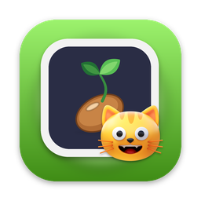
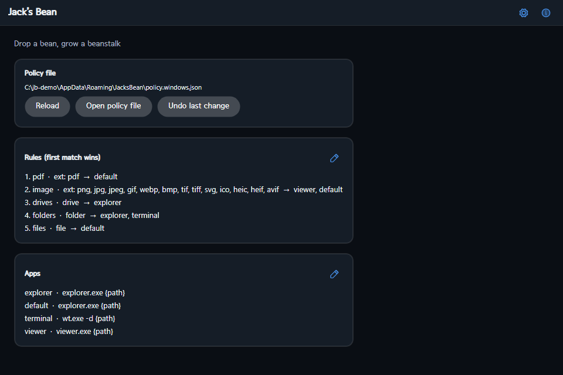
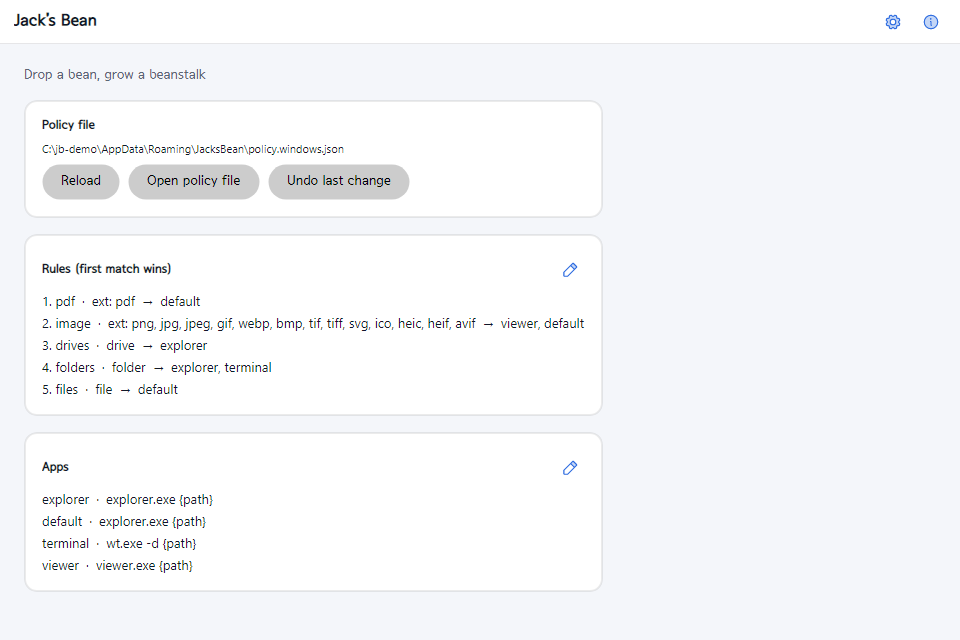
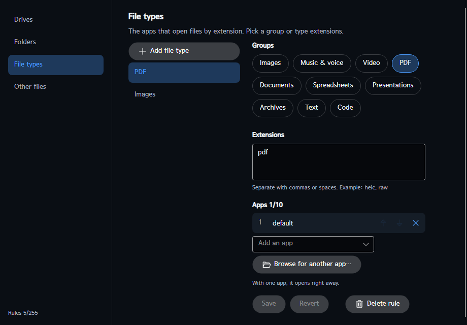

<div align="center">



# Jack’s Bean

**Drop a bean, grow a beanstalk** — a free, open-source **drag-and-drop launcher** for Windows, macOS and Linux: drop any file, folder or drive on a small always-on-top dock and it opens with the app *your rules* choose.

[](https://github.com/jejezz/jackbean-avalonia/releases/latest)
[](https://github.com/jejezz/jackbean-avalonia/releases)
[](#install)
[](https://learn.microsoft.com/dotnet/core/deploying/native-aot/)
[](LICENSE)

English · [한국어](README.ko.md)

</div>

## Screenshots

| Home — dark | Home — light |
| :---: | :---: |
|  |  |



## Features

- **Rules you can read** — four targets: **drives**, **folders**, **file types** (by extension) and **everything else**. Each target links up to **10 apps**: one app opens at once; two or more asks you to choose among *only those apps* (drop a folder and you never see your PDF viewer).
- **Edit without touching JSON** — a rule editor with extension groups (images, music & voice, video, PDF, documents, spreadsheets, presentations, archives, text, code), up to **255 rules**, overlap checks, drag-free reordering of linked apps, and one-step **undo**. Pick any program with *Browse for another app…*.
- **“Always open this way”** — tick it in the chooser and the rule is saved for you.
- **Built-in image viewer** — opens in its own window, one window per file.
- **Sync across PCs with GitHub** — sign in from the browser (OAuth device flow), pick or create a private repository, press *Sync now*. Rules and apps are merged **per item** (the more recent edit wins; deletions follow). No git needed; the token lives only in the OS secure store (Credential Manager / Keychain / libsecret).
- **A dock that stays out of the way** — sits at a screen edge, remembers where you put it, shows a ring when you drag over it. A tray icon, a **global shortcut** (Ctrl+Alt+J, Windows) and **start at login** are in Settings.
- **Looks right** — light/dark, six color palettes including high contrast, 80–160% text size, Korean/English, bundled SeoulNamsan font with a system-font option for file names.
- **Small and fast** — one **NativeAOT** executable; no .NET runtime to install.

## Install

Download the file for your OS from the [latest release](https://github.com/jejezz/jackbean-avalonia/releases/latest) (`<version>` stands for the release number):

| OS | File | Notes |
|---|---|---|
| Windows 10/11 (x64) | `JacksBean-<version>-windows-x64-setup.exe` or `…-windows-x64.zip` | Not code-signed yet: SmartScreen shows “Windows protected your PC” — choose **More info → Run anyway**. |
| macOS (Apple Silicon, 11.0+) | `JacksBean-<version>-macos-arm64.dmg` | Not notarized yet: **right-click → Open** once, or `xattr -dr com.apple.quarantine "/Applications/Jack’s Bean.app"`. |
| Linux (x64) | `JacksBean-<version>-linux-x64.tar.gz` | Unpack and run `./install.sh` (`--remove` uninstalls). X11/XWayland; the tray icon needs StatusNotifier support; no global shortcut. |

Check a download with `SHA256SUMS.txt`: `shasum -a 256 -c SHA256SUMS.txt --ignore-missing`.

**First run**: drop something on the dock (the small circle at the screen edge). Double-click it, or use the tray icon, to open the home window where rules and apps live. Your policy is a plain JSON file (`policy.<os>.json`) in the user data folder `JacksBean`.

## How it works

The dock is a separate always-on-top window, and the home window, settings, editors and built-in tools are **independent windows** too — that is the reason this app is written in Avalonia rather than a single-window toolkit. A drop is classified (drive / folder / file + extension), matched against the policy from top to bottom (most specific rule first), and launched **without a shell**, so odd file names can never be interpreted as commands.

## Development

```bash
dotnet build JackBean.slnx
dotnet test JackBean.slnx
dotnet run --project src/JackBean.App               # --home --settings --about open those windows too
./scripts/publish-aot.sh                            # NativeAOT → publish/aot (Windows: scripts\publish-aot.ps1)
```

Structure and conventions: [CLAUDE.md](CLAUDE.md) · plans and decisions: [ROADMAP.md](ROADMAP.md). To enable browser sign-in in your own build, register a GitHub OAuth App (enable *Device Flow*), then copy `Directory.Build.local.props.example` to `Directory.Build.local.props` and fill in the Client ID (without one, the app offers token sign-in only).

Releases are cut by pushing a `vX.Y.Z` tag (`.github/workflows/release.yml` builds the installers for all three OSes and publishes them together).

### Adding a built-in tool

Implement `IBuiltInTool` (one window per file), register it in `App.OnFrameworkInitializationCompleted`, and point an app in the policy at `jackbean:<id>`.

## Credits

- [Avalonia](https://avaloniaui.net) (MIT), [SkiaSharp](https://github.com/mono/SkiaSharp) and [HarfBuzzSharp](https://github.com/mono/SkiaSharp) (MIT)
- [Phosphor Icons](https://phosphoricons.com) (MIT)
- [SeoulNamsan](https://www.seoul.go.kr/) font (Seoul Metropolitan Government, KOGL Type 1 — attribution)

Full license texts are in the app (*About → Open-source licenses*) and in `src/JackBean.App/Assets/Licenses`.

## License

[MIT](LICENSE) © 2026 Jongyun Ahn
